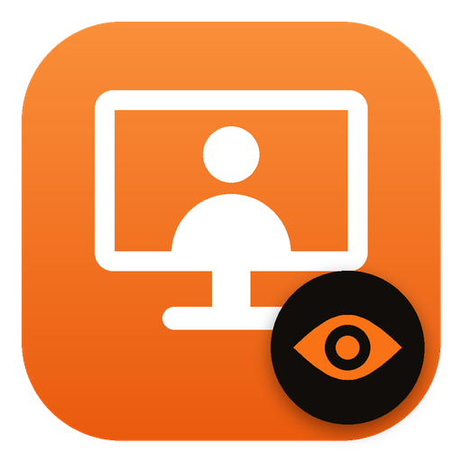

<p align="center">
  
</p>

# DeskPresence

**Your PC knows when you leave the desk. It uses the webcam to pause your music and turn the monitors off when you get up, and brings both back when you sit down again.**

[](https://github.com/Jolly-Panda-Works/DeskPresence/actions/workflows/build.yml)
[](https://github.com/Jolly-Panda-Works/DeskPresence/releases/latest)
[](https://github.com/Jolly-Panda-Works/DeskPresence/releases)
[](LICENSE)
[](#download)

[Download](https://github.com/Jolly-Panda-Works/DeskPresence/releases/latest/download/DeskPresence_Setup.exe) · [فارسی](README.fa.md) · [Report a bug](https://github.com/Jolly-Panda-Works/DeskPresence/issues/new?template=bug_report.md) · [Request a feature](https://github.com/Jolly-Panda-Works/DeskPresence/issues/new?template=feature_request.md)

---

## Features

| | |
|---|---|
| **Leave the desk** | The webcam no longer sees you, or your phone leaves Bluetooth range (and the keyboard/mouse is idle) → music and videos pause and all monitors turn off. The PC keeps running. |
| **Webcam only now and then** | By default the webcam is off. It opens for a quick look every 3 minutes, and not at all while you use the keyboard or mouse. While you are away it takes a short look every 20 seconds (the keyboard and mouse work at once too). *Always on* is still there for the head and eye cursor features. |
| **Turning your head is fine** | You count as here when your **body** is seen, not only your face: looking at your phone, turning to someone or sitting sideways does not turn the monitors off. |
| **Only you** | Optional: teach DeskPresence your face (Settings → Presence → *Only me*). Then only your face turns the monitors back on. If someone else touches the keyboard or mouse, the screens go dark again after a few seconds. |
| **Come back** | Monitors turn back on and the **music** DeskPresence paused plays again. Videos stay paused. |
| **Mouse follows your gaze** | *Jump to monitor*: turn your head and the cursor jumps to that monitor. *Follow my eyes*: the cursor moves to where you look (iris tracking, toggle with Ctrl+Alt+E). |
| **Phone instead of webcam** | Use your paired phone over Bluetooth, with or without the webcam. No app needed on the phone. |
| **Shares the webcam** | When a video app starts (Zoom, Teams, Camera, OBS, or any app that used the webcam before), DeskPresence asks and hands the webcam over, then takes it back when that app is done. *Release webcam* in the widget frees it by hand. |
| **Settings window** | Every option, a live webcam preview, phone range test, laptop pairing with automatic discovery and a connection test. |
| **Water reminder** | After every hour at the desk: “Time to drink water!” with *I drank ✓* / *In 10 minutes*. The **I drank** button in the widget, the tray menu and Settings restarts the timer. |
| **Timer widget** | A small always-on-top window: status, time to the next water reminder and break, time at the desk, eye-control and webcam buttons. Drag it anywhere. |
| **Fair timers** | Timers only count time at the desk: they pause while you are away and continue when you are back. Away 10+ minutes counts as a break and restarts the break / stand-up timers. |
| **Phone calls** | With Windows Phone Link, an incoming call pauses music and video; music resumes after the call. |
| **Forced break** | After 90 minutes of work, every screen is covered for a 10-minute break. The countdown **only runs while the camera does not see you**, so sitting there does not count. Leaving for 10+ minutes on your own counts as a break too. |
| **Laptop companion** | Run it on your laptop too: its screen and music follow the desktop, it shows the break screen, and its notifications are forwarded to one monitor of the desktop. |
| **Mouse Without Borders** | Use one mouse and keyboard for both machines (PowerToys). Optionally the cursor even moves to the laptop when you look at it. |
| **Persian and English** | The app and the installer. Switch in Settings → General. |

Everything runs locally. Webcam frames are processed in memory and are never saved or uploaded. See [PRIVACY.md](PRIVACY.md).

## Music & video apps

Apps are detected automatically through Windows' media controls, which list every app that shows up in the volume flyout:

| Kind | When you leave | When you come back | Examples |
|---|---|---|---|
| Music | pause | play again | Spotify, Radio Javan, Media Player (music), YouTube Music, foobar2000, AIMP, MusicBee, Apple Music, Deezer |
| Video | pause | stays paused | YouTube, Media Player (video), Movies & TV, VLC (video), PotPlayer, MPC-HC, Netflix |

Apps that are not in the built-in list are classified by what they report to Windows (music or video). Browser tabs count as music when the track has an album (YouTube Music, Spotify web, ...) and as video otherwise.
To change any app: tray menu → **Music & video apps** → *Music: pause and resume* / *Video: pause only* / *Leave alone*. An app appears in that list once it has played something.

## Download

1. Download **[DeskPresence_Setup.exe](https://github.com/Jolly-Panda-Works/DeskPresence/releases/latest/download/DeskPresence_Setup.exe)** and run it. The installer asks where to install, and offers a desktop shortcut and *Start with Windows*. No administrator rights are needed.
   Prefer no installer? Download **[DeskPresence_Portable.zip](https://github.com/Jolly-Panda-Works/DeskPresence/releases/latest/download/DeskPresence_Portable.zip)**, unzip it anywhere and run `DeskPresence.exe`.
2. An orange icon appears next to the clock. The coloured dot shows the status: green = at the desk, yellow = away, blue = on a break, grey = paused. **Left-click it to open Settings.**
3. In Settings → *Mouse & gaze*, choose a mode and run its calibration.

> Windows SmartScreen may warn about an unsigned app the first time: *More info → Run anyway*. The SHA-256 checksums of every release are in `SHA256SUMS.txt`.

## Phone over Bluetooth

1. Pair your phone with the PC once (Windows Settings → Bluetooth & devices → Add device).
2. DeskPresence → Settings → *Phone (Bluetooth)*: choose the phone and press *Test*.
3. Settings → *Presence* → *Detect with*: **Phone** (no webcam at all) or **Both** (away only when neither the webcam nor the phone sees you).

The phone is checked every few seconds. A phone in range answers within a fraction of a second; when it is out of range (about 5–10 m, depending on walls) it stops answering and you count as away. If you leave the phone on the desk, use the webcam instead.

## Sharing the webcam

Most webcams can only be used by one app at a time, and Windows does not tell the app holding it when another app tries and fails. So DeskPresence watches for video apps starting: the well-known ones (Zoom, Teams, Camera, OBS, Skype, Webex, ...) and every app Windows lists as having used the webcam before. When one starts, DeskPresence asks *“Zoom wants to use the webcam — hand it over?”* (or always / never, in Settings → Presence). For a call in the browser (Google Meet, ...) press **Release webcam** in the widget, and **Take webcam back** afterwards. While that app has it, presence comes from your phone, or from keyboard/mouse inactivity (5 minutes by default). When that app is done, DeskPresence takes the webcam back by itself.

## Laptop setup

1. Install DeskPresence on both machines (and **[PowerToys](https://learn.microsoft.com/windows/powertoys/)** with **Mouse Without Borders** for one mouse and keyboard).
2. On the main PC: Settings → *Laptop link* → turn on **Link enabled** → **Allow in firewall…** (one admin prompt) → **Copy** the token.
3. On the laptop: Settings → *General* → *This device is* → **Companion laptop**. Then *Laptop link* → **Link enabled**, **Find automatically**, paste the token, **Test**.
4. Settings save by themselves; the status line shows *Connected to …* on both machines.

Not connecting? *Find automatically* asks every address of your home network directly, so it also works when the router drops broadcasts or a VPN is installed. The usual cause is the firewall on the main PC: if its first “allow access” prompt was closed, Windows silently blocks DeskPresence; **Allow in firewall…** removes that block.
5. On the laptop, turn on **Do not disturb**. Its notifications are still forwarded and appear on the monitor chosen in *Laptop link → Notifications*.

Windows always shows the main PC's own notifications on the *main display*. To choose which monitor that is: Windows Settings → System → Display → *Make this my main display*.

## Settings

Everything is in the Settings window. The same values live in `%APPDATA%\DeskPresence\config.json` (tray menu → *Settings file (advanced)*, then *Apply saved settings*).

| Key | Default | Meaning |
|---|---|---|
| `language` | `auto` | `auto`, `fa` or `en` |
| `presence_source` | `camera` | `camera`, `phone` or `both` |
| `phone` | | `device_id`, `check_seconds` (8), `away_checks` (2) |
| `camera_share` | `ask` | `ask`, `always` or `never` |
| `idle_fallback_minutes` | 5 | Away after this much inactivity when neither webcam nor phone is available |
| `mouse_mode` | `monitor` | `off`, `monitor` or `eyes` (Ctrl+Alt+E or the 👁 button turns eye control on/off) |
| `timer_reset_away_minutes` | 10 | Being away this long restarts the break and stand-up timers |
| `pause_on_call` | true | Pause media during Phone Link calls |
| `widget` | on | The floating timer widget (`enabled`, position) |
| `eye_deadzone_px` | 90 | Eye mode ignores gaze changes smaller than this |
| `camera_mode` | `interval` | `interval` (a look every few minutes, webcam off in between) or `always` |
| `check_every_minutes` | 3 | Interval mode: minutes between looks (skipped while you type) |
| `away_check_seconds` | 20 | Interval mode, while away: seconds between short looks |
| `presence_by` | `body` | `body` (a person from any side) or `face` |
| `owner_only` | false | Only the owner's face turns the PC back on (needs *Teach my face*) |
| `away_seconds` | 10 | Seconds without seeing you before you count as away |
| `idle_guard_seconds` | 20 | Never turn anything off if the keyboard/mouse was used this recently |
| `wake_on_input` | true | Touching the keyboard/mouse also means you are back |
| `camera_index` | 0 | Which webcam to use |
| `water_reminder_minutes` | 60 | `0` = off |
| `forced_break` | 90 / 10 | `work_minutes`, `break_minutes`, `enabled`, `allow_skip` |
| `break_reminder_minutes` | 50 | A gentle “stand up” popup (`0` = off) |
| `lock_after_away_minutes` | 0 | Lock Windows after being away this long (`0` = never) |
| `gaze_stable_seconds` | 0.6 | How long you must look at a monitor before the cursor moves |
| `notification_monitor` | -1 | `-1` = main display, else 0, 1, … from left to right |

## Run from source

```bash
pip install -r requirements-dev.txt
```
```bash
python scripts/download_model.py
```
```bash
python run.py
```

Run the tests with `python -m pytest`. Regenerate the icons with `python tools/make_icons.py`.

## How the GitHub Action builds it

Every push builds DeskPresence on `windows-latest` after the tests pass, self-tests the built app, packs the installer (Inno Setup, English + Persian) and a portable zip, and keeps it for 14 days under *Actions → the run → Artifacts*.

| Build from | Version | Published |
|---|---|---|
| `main` | `MAJOR.MINOR.<run number>`, e.g. `1.3.42` | Git tag + public GitHub Release with the installer and the portable zip |
| a tag `vX.Y.Z` | `X.Y.Z` | GitHub Release |
| any other branch / PR | `MAJOR.MINOR.0-dev.<run>` | Artifact only |

`MAJOR.MINOR` comes from the [`VERSION`](VERSION) file. The version shows up in the About window, the exe's file properties and the release name.

## Project structure

```
deskpresence/
  controller.py     presence state machine, breaks, water, gaze -> cursor, laptop sync
  vision.py         webcam + YuNet face detector + head-pose estimate, person detector, owner recognition
  eyetrack.py       MediaPipe iris tracking -> cursor (calibrated regression)
  phone.py          Bluetooth phone presence
  camshare.py       notices other apps that want the webcam
  calls.py          phone calls through Windows Phone Link
  firewall.py       the Windows Firewall rule for the laptop link
  widget.py         the floating timer widget
  settings_ui.py    the Settings window (customtkinter)
  media.py          pause / resume through Windows media sessions
  winapi.py         monitors, cursor, power, keyboard (ctypes)
  network.py        desktop <-> laptop link (JSON lines over TCP, shared token)
  notifications.py  reads Windows notifications on the laptop
  ui.py             popups, break screen, calibration, About (Tk)
  tray.py           tray icon and menu
  i18n.py           Persian / English strings
tools/              set_version.py, make_icons.py
tests/              pytest suite (runs in CI before every build)
```

## Contributing

Pull requests are welcome. See [CONTRIBUTING.md](CONTRIBUTING.md). Please report security issues privately as described in [SECURITY.md](SECURITY.md).

## License

[MIT](LICENSE) © 2026 [Usef Farahmand](https://github.com/Usef-Farahmand) · [useffarahmand.com](https://www.useffarahmand.com/)

Face detection uses the [YuNet](https://github.com/opencv/opencv_zoo/tree/main/models/face_detection_yunet) model from OpenCV Zoo (MIT). Eye tracking uses Google's [MediaPipe Face Landmarker](https://ai.google.dev/edge/mediapipe/solutions/vision/face_landmarker) (Apache 2.0).
